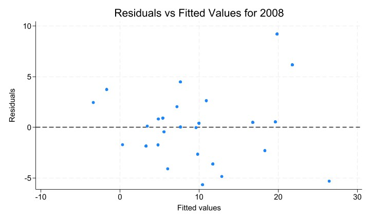

# Government Spending and Inflation During the Financial Crisis

A cross-country econometric study of the association between government spending and inflation in **2008 and 2009**, using 25 countries and separate annual ordinary least squares regressions.

**[Full report](docs/report.pdf)** · [Reproducible R analysis](src/analysis.R) · [Research notes](docs/research-notes.md)

## Research question and methodology

Was government spending as a share of GDP associated with inflation during the financial crisis, after accounting for macroeconomic conditions?

The response is GDP-deflator inflation. Model 1 includes spending, real interest rates, government debt, unemployment, GDP growth, and broad money as a share of GDP. Model 2 adds the supplied developed-economy indicator. The report examines residual plots, variance inflation factors, and heteroskedasticity; it presents robust standard errors for 2008.

The observations are country aggregates, not individual records. The study uses World Bank and Our World in Data downloads, plus a supplied GDP-deflator workbook. The saved analysis table contains 25 countries for both years, after the reported exclusion of Azerbaijan. See [data provenance](data/README.md).

## Main results

Reported OLS values from Tables 8–9 (standard errors in parentheses):

| Model | Year | Spending coefficient | R² | Countries |
| --- | --- | --- | --- | --- |
| 1 | 2008 | 0.145 (0.090) | 0.8121 | 25 |
| 1 | 2009 | 0.020 (0.084) | 0.8213 | 25 |
| 2 | 2008 | 0.162 (0.092) | 0.8204 | 25 |
| 2 | 2009 | 0.035 (0.083) | 0.8373 | 25 |

The report's overall conclusion is that spending is not significantly associated with inflation in these specifications; real interest rates and broad money have negative estimated coefficients. Model 2's 2008 significance annotations are inconsistent between the report's tables and text. The [research notes](docs/research-notes.md) discuss this explicitly; the table above omits significance stars.

**Reproduction discrepancy:** fitting these equations to the supplied CSV does not reproduce the report's coefficients or R² values. For example, Model 1's spending coefficients are approximately 0.178 (2008) and 0.048 (2009) in a fresh run. [Verification results](results/verification_spending_coefficients.csv) are recorded separately; the original report and dataset have not been altered to force agreement.



These are small-sample observational associations. They do not identify a causal fiscal-policy effect or establish that government spending has no effect on inflation.

## Reproduce

Install R 4.1 or later, then run from this repository:

```bash
Rscript install.R
Rscript src/analysis.R
```

The script uses the supplied processed CSV, fits the four reported specifications, and writes coefficient tables, conventional and HC1 standard errors, VIFs, residual plots, a Stata-compatible input CSV, and session information into `results/rerun/`. Original results remain untouched.

With a licensed Stata installation, run `do src/analysis.do` from the repository root after the R analysis. Stata is optional. The older R preparation scripts are preserved as exploration; they are not a complete reconstruction of the final processed dataset.

## Repository and limitations

- `data/`: small original data snapshots, the final analysis table, and provenance notes.
- `src/`: the main R and Stata analyses; `exploration/` preserves earlier work.
- `results/` and `figures/`: original descriptive tables and diagnostic plots.
- `docs/`: report, research notes, and archived research session/history.

Missing observations restrict coverage, the development indicator's construction is not scripted, and the preparation history is incomplete. The report also uses inconsistent labels for several indicators. Lagged responses and broader country coverage are possible extensions, not completed experiments.

Genrikh Vetsler · University College Roosevelt · Econometrics, Fall 2024.
